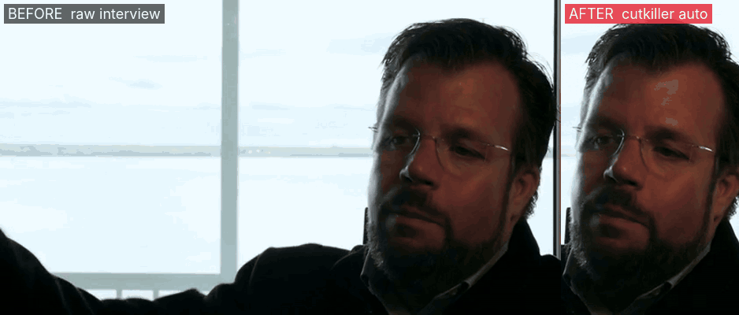

# CutKiller

**The open-source video editor that grades its own work.**

Raw footage in → a publish-ready YouTube video, Short, TikTok or Reel out — edited locally, for free, and delivered with a **quality report scored on 26 measurable rules**.

[](https://github.com/BaldW1N69/CutKiller/actions/workflows/ci.yml)
[](LICENSE)
[](https://github.com/BaldW1N69/CutKiller/pkgs/container/cutkiller)

[**Documentation**](https://baldw1n69.github.io/CutKiller/) · [Français](README.fr.md) · [Roadmap](ROADMAP.md) · [Benchmark vs auto-editor](docs/BENCHMARK.md) · [EDL reference](docs/EDL.md) · [Architecture](docs/AUDIT.md)

```sh
docker run --rm -v "$PWD:/work" -v cutkiller-models:/models \
  ghcr.io/baldw1n69/cutkiller auto interview.mp4 music.mp3 -p short -o out
```

<p align="center"></p>
<p align="center"><sub>Real run on a 60 s CC BY interview (Global Lives Project, 640×360): <code>cutkiller auto interview.mp4 music.mp3 -p short</code>, no manual step.</sub></p>

```
ℹ [language] fr
ℹ [cut.summary] 1 hesitation(s) and 0 false-start word(s) removed, 6.3 s cut, 23 shot(s)
ℹ [reframe.summary] 23 shot(s) reframed on the face, 0 camera move(s)
ℹ [captions.summary] 72 caption screen(s), 145 word(s), style karaoke-pop@1.0.0
ℹ [audio.summary] 1 ducking zone(s), 5 SFX, target -14 LUFS
# Quality check — 97.8/100
```

The 2.2 points lost are honest: the source is 640×360, so the report flags the ×5 upscale (`image.sharpness`) and two caption words 4 frames off.

## Why CutKiller

Other AI video tools generate clips or cut silences. CutKiller edits **your real footage** like an editor would, then **proves** the result meets broadcast and platform standards:

| | CutKiller |
|---|---|
| **Cuts** | Silences, hesitations (« um », « euh », « äh »…), false starts and repeated takes, word-accurate (forced alignment, ~20 ms) |
| **Rhythm** | Free cuts snapped to the music's beats, zoom cuts and animated punch-ins on emphasised words, motion blur on fast moves |
| **Vertical** | 16:9 → 9:16 with a virtual camera that follows the face (dead zone, anticipated glides, bounded acceleration) |
| **Captions** | Word-by-word karaoke captions inside each platform's safe zones, WCAG contrast, plus an `.srt` file |
| **Sound** | Voice at -14 LUFS, true peak ≤ -1 dBTP after AAC encoding, music ducked under speech, SFX synced to the frame |
| **Image** | Skin matched shot to shot, six looks (film-print, bleach-grit, neon-80s, teal-orange, noir, clean), grain, letterbox |
| **B-roll** | Cutaways placed over speech, framed for vertical, or a music-driven montage when there is no speech |
| **Shorts** | `cutkiller shorts`: a long recording becomes N Shorts that open on their strongest line, ranked by hook and quality score — offline, or chosen by Claude with `--ai` |
| **Proof** | `quality.md` / `quality.json`: every rule's threshold, measurement, violations with timecodes, a score out of 100 |
| **Control** | Everything goes through an [EDL in JSON](docs/EDL.md) you (or an AI agent) can edit by hand and re-render |
| **Languages** | Auto-detected: English, French, Spanish, German, Italian, Portuguese, Dutch (other languages: transcription and universal fillers) |

The QA is calibrated, not decorative: for each rule, one defect is injected into a clean edit and must be caught, while clean controls must pass ([calibration report](docs/phases/phase-7.md)). On real CC-licensed interviews the pipeline scores 97.5–99.9/100 ([phase 8 report](docs/phases/phase-8.md)).

## Install

### Docker (recommended: nothing else to install)

```sh
docker run --rm ghcr.io/baldw1n69/cutkiller doctor
```

Mount your folder on `/work` and a volume on `/models` so speech models (downloaded on first use) are kept between runs.

### From source

Requirements: Node 22+, pnpm 10 (`corepack enable`), FFmpeg 6+, [uv](https://docs.astral.sh/uv/).

```sh
git clone https://github.com/BaldW1N69/CutKiller && cd CutKiller
pnpm install && (cd workers && uv sync)
pnpm cutkiller doctor
```

First run downloads Whisper `large-v3-turbo` (~1.6 GB) and the aligner of the spoken language (~1.3 GB) into `~/.cache/cutkiller`. On a CPU, analysis takes about 1× real time; results are cached by content. Lighter model: `CUTKILLER_WHISPER_MODEL=small`.

## Usage

```sh
# One command: EDL + render + quality report in out/
cutkiller auto rushes/*.mp4 music.wav -p short -o out --min-score 90

# Cinematic: interview + B-roll + music, neon look
cutkiller auto interview.mp4 music.wav --broll street.mp4 --broll hands.mp4 -p cinematic --look neon-80s -o out

# Step by step, editing the EDL in between
cutkiller plan rushes/*.mp4 -p long -o out/edit.edl.json      # analysis + planning → editable EDL
cutkiller render out/edit.edl.json -o out/final.mp4 --draft   # fast encode to iterate
cutkiller check out/final.mp4 --edl out/edit.edl.json -p long --md out/quality.md

# A 60 s version of a long video: strongest sentences, strongest hook first (--ai: chosen by Claude)
cutkiller auto talk.mp4 music.mp3 -p long -o recap --target 60

# One long video → the 5 best Shorts, each edited, scored and ranked (--ai: Claude picks the clips)
cutkiller shorts podcast.mp4 music.mp3 -p short -o shorts --count 5 [--ai]

# Compare your render with a reference video (rhythm, image, sound)
cutkiller reference reference.mp4 --against out/final.mp4
```

| Option | |
|---|---|
| `-p short\|long\|cinematic\|cinematic-short` | Style profile (9:16 or 16:9), or a path to your own `.yaml` ([profiles/](profiles)) |
| `--lang en` | Force the spoken language (default: detected per rush) |
| `--look <name>` | Image style; `cutkiller looks` lists them |
| `--broll <file>` | Cutaway footage (repeatable) |
| `--draft` | Fast x264 preset for iterations |
| `--fast` | No speech or beat analysis (assembly and zoom cuts only) |
| `--min-score 90` | Exit code 1 if the quality score is lower (CI-friendly) |
| `CUTKILLER_LANG=fr` | Messages and reports in French (English by default) |

## How it works

```
rushes ─► analyze ─► plan passes (pure EDL → EDL) ─► render ─► quality-check
          Whisper     cut → broll → reframe → color    FFmpeg      26 rules,
          CTC align   → motion → captions → audio      + Cairo     score /100
          VAD, beats,
          faces, skin
```

| Stage | Package | Role |
|---|---|---|
| Analysis | `@cutkiller/analyze` + `workers/` (Python) | Probe; word-level transcription and forced alignment per language, VAD, prosody, beats, faces and skin colour |
| EDL | `@cutkiller/core` | Schema, validator, integer frame times ([reference](docs/EDL.md), [JSON Schema](schema/edl-1.schema.json)) |
| Planning | `cut`, `broll`, `reframe`, `color`, `motion`, `captions`, `audio` | Pure `EDL → EDL` passes in a fixed order |
| Render | `@cutkiller/render` | Per-clip FFmpeg decode, 3D LUT grading, Cairo compositor (animations, motion blur, captions), CFR encode; stem mix with EBU R128 loudness and limiter |
| QA | `@cutkiller/qa` | 26 rules, each measured on the render, the EDL or the render log |

## Development

```sh
pnpm check && pnpm typecheck && pnpm test     # lint, types, unit + FFmpeg integration + end-to-end
(cd workers && uv run pytest && uv run ruff check .)
pnpm fixtures                                  # synthetic test media (needs espeak-ng)
pnpm run docs:rules                                      # regenerates docs/rules.md from the rule table
```

Test media are generated on the fly (FFmpeg test patterns, espeak-ng voices in French and English with word-level ground truth). No media is committed except OFL fonts.

Contributions are welcome: see the [roadmap](ROADMAP.md) for what comes next.

## License

[Apache-2.0](LICENSE). Third-party sources, models and assets: [LICENSES.md](LICENSES.md).

Demo footage: Global Lives Project, « Pierre Vallee, Trois-Rivières » ([archive.org](https://archive.org/details/globallivesproject_Pierre_Vallee_2013_fra_Trois_Rivieres_CA-QC-010004-013005_life_story_interview)), CC BY 3.0, edited by CutKiller. Music: Cely Grande, « Thunder », CC0.
