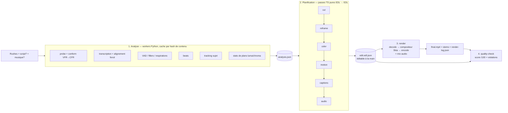

# Phase 0 — Audit CutKiller

> Statut : **en attente de validation**. Rien n'est implémenté tant que ce document n'est pas validé.
> Date : 2026-09-30.

## 0. Synthèse

- **Les deux sources ne font pas ce que CutKiller doit faire.** OpenCut est un éditeur *interactif* dans le navigateur, et claude-code-video-toolkit est un *générateur* de vidéos explicatives par IA (TTS, images générées). Aucun des deux ne monte des rushes automatiquement.
- **Le zip OpenCut fourni est la réécriture 2026, presque vide** : environ 130 fichiers, des panneaux « Timeline » et « Preview » de 20 lignes, aucun moteur. La timeline et le rendu sont dans `opencut-app/opencut-classic`, que j'ai aussi audité (commit `cf5e79e`).
- **Le « CapCut AI toolkit » n'a rien à voir avec CapCut.** C'est `digitalsamba/claude-code-video-toolkit` (MIT). On n'y trouve **aucune** référence à CapCut, ByteDance, Jianying ou Douyin (grep à 0 résultat). Il n'y a donc pas de risque de contamination par du code propriétaire, mais pas non plus de fonctions « CapCut » à récupérer.
- **Réutilisation de code : presque nulle.** Ce qu'on récupère, ce sont surtout des idées : `MediaTime` en ticks entiers, les parseurs SRT/ASS, l'alignement script→transcription, le test de non-régression par rendu A/B. Environ 95 % du moteur est à écrire.
- **Remotion n'est pas open source.** C'est une licence *source-available* : gratuite jusqu'à 3 salariés, licence entreprise payante au-delà. Je propose de ne pas le mettre dans le cœur du projet.
- **Stack recommandée** : cœur TypeScript (EDL, passes de montage, compositeur, QA) avec des workers Python d'analyse (faster-whisper, alignement forcé, librosa, MediaPipe). Le rendu passe par un décodage FFmpeg, un compositeur Skia, puis un encodage FFmpeg.
- **Trois règles de `<standards_qualite>` sont irréalisables ou contradictoires telles qu'elles sont écrites.** Il s'agit de la synchro des sous-titres ≤ 1 frame dans 100 % des cas, des coupes sur les beats en présence de parole, et de « zéro frame dupliquée » avec 60 fps ou des plans fixes. Des reformulations mesurables sont proposées au §6.

---

## 1. Sources auditées

| Source | Ce qui a été fourni | Contenu réel | Licence |
|---|---|---|---|
| OpenCut (zip `OpenCut-main`) | Réécriture 2026 | Shell desktop GPUI (Rust) avec des panneaux vides, 60 composants UI shadcn, une API Elysia qui n'expose que `/health`, et un script de build FFmpeg **LGPL, décodage seul** (`--disable-avfilter`, sans x264) | MIT © 2026 OpenCut |
| opencut-classic (cloné en plus) | — | Éditeur web Next.js : timeline (~17 k lignes UI), keyframes avec courbes de Bézier, ripple, compositeur Rust/wgpu→WASM, transcription transformers.js **au segment**, export mediabunny. Tout est lié au navigateur (AudioContext, IndexedDB, WebGPU) | MIT © 2025-2026 OpenCut |
| claude-code-video-toolkit (zip) | « CapCut AI toolkit » | Kit Claude Code de Digital Samba : templates Remotion, transitions React, outils Python (TTS ElevenLabs/Qwen3, FLUX, LTX-2, SadTalker, dewatermark, upload YouTube), GPU cloud (Modal/RunPod), un template 9:16 moviepy avec sous-titres Whisper | MIT © 2024 Digital Samba |

---

## 2. Garder / jeter / réécrire

Légende : **Garder** = code copié tel quel, avec en-tête MIT. **Réécrire** = on reprend l'idée ou l'algorithme, avec une nouvelle implémentation. **Jeter** = hors périmètre ou inadapté.

### 2.1 OpenCut (réécriture + classic)

| Élément | Décision | Justification |
|---|---|---|
| `MediaTime` en ticks entiers 120 000/s + `FrameRate` rationnel (classic `rust/crates/time`) | **Réécrire** en TS (~150 lignes) | Excellente idée : pas de dérive des flottants, et 120 000 se divise exactement par 23.976/29.97/30/60. Le crate Rust exige une chaîne WASM qui est disproportionnée ici |
| Keyframes + solveur de Bézier (classic `animation/bezier.ts`, `interpolation.ts`) | **Réécrire** | Utile comme référence. Mais le solveur fait une bissection sur des poignées de type After Effects, alors qu'il nous faut du `cubic-bezier` CSS, des springs et la détection du linéaire |
| Parseurs SRT / ASS (classic `subtitles/srt.ts`, `ass.ts`) | **Garder** (MIT, attribution) | Import/export de sous-titres : un SRT pour YouTube est un livrable attendu par un monteur |
| Algorithme ripple (classic `ripple/diff.ts`) | Jeter | Dans un pipeline génératif, la timeline est construite séquentiellement, donc pas de ripple à gérer |
| Compositeur Rust/wgpu→WASM, masques JFA, effets | Jeter (v1) | Ciblé WebGPU navigateur. En headless, il faut un GPU ou lavapipe. À reconsidérer plus tard comme backend GPU |
| UI timeline, éditeur, stores, IndexedDB | Jeter | Hors périmètre (pipeline batch). Pour la retouche humaine, on propose plutôt un export OTIO/FCPXML vers Resolve/Premiere (§4.6) |
| Transcription (transformers.js, Whisper ONNX) | Jeter | Timestamps **au segment** seulement, et exécution dans le navigateur |
| `audio-mastering.ts` (limiteur de crête) | Jeter | Aucune notion de LUFS ni de true peak |
| Build FFmpeg LGPL épinglé (réécriture `crates/media/setup`) | **Réécrire** l'idée (épinglage + sha256) | Leur build est inutilisable pour nous : sans filtres (loudnorm, ebur128, lut3d, blackdetect) ni encodeurs x264/x265 |
| Shell GPUI, UI shadcn, API Elysia, Cloudflare | Jeter | Squelettes sans fonctionnalité |

### 2.2 claude-code-video-toolkit

| Élément | Décision | Justification |
|---|---|---|
| `align()` : alignement script→mots Whisper par difflib, avec interpolation des trous (`gen_captions.py`) | **Garder** (MIT, attribution), puis adapter | C'est exactement le cas « rushes + script fourni ». La transcription du rendu ne doit pas trahir le texte du script |
| `chunk()` : découpage des sous-titres | Réécrire | Trop simple : pas de gestion 2 lignes / 32 caractères, pas de césure sémantique, pas de mot actif |
| Transitions `lib/transitions` (glitch, zoom-blur, rgb-split, light-leak…) | **Réécrire** en presets du compositeur | Composants React liés à Remotion, et ils **violent la règle anti-linéaire** (`interpolate()` sans easing sur l'échelle et l'opacité, cf. `zoom-blur.tsx`) |
| Ken Burns (`build.py`) | Jeter | Zoom linéaire, donc interdit |
| Musique (`addmusic.py`, `build.py`) | Jeter | Volume constant (0.15–0.16) sans ducking |
| SFX (`sfx.py`) | Jeter | Dépend de l'API propriétaire ElevenLabs. Remplacé par des SFX synthétisés procéduralement (whoosh, pop, hit), déterministes et libres de droits |
| Mesure WPM (`pacing.py`) | Jeter (idée notée) | Pas de règle associée. Pourra servir plus tard en diagnostic QA |
| Test render-baseline (rendu A/B + diff pixel lors d'une mise à jour de dépendance) | **Réécrire** l'idée | Bonne pratique : protège le compositeur contre les régressions de Skia ou FFmpeg sans images « golden » dépendantes de la machine |
| TTS, FLUX, LTX-2, SadTalker, dewatermark, Modal/RunPod, upload YouTube, skills Claude | Jeter | Génération IA ou cloud, hors périmètre. `dewatermark` pose en plus un problème juridique |

---

## 3. Licences (résumé — détail dans [`LICENSES.md`](../LICENSES.md))

- Les 3 sources sont en **MIT** : tout fichier copié garde l'en-tête de copyright et sera listé dans `LICENSES.md`.
- **CutKiller est actuellement en CC0-1.0** (fichier `LICENSE` du repo). C'est compatible avec l'inclusion de code MIT, à condition de conserver les notices. En revanche, CC0 n'accorde **aucune licence de brevet**. Je recommande MIT ou Apache-2.0 : c'est à toi de décider (question Q7).
- **Écartés pour raison de licence** :
  - Remotion : source-available, payant au-delà de 3 salariés, et la redistribution d'un dérivé est interdite.
  - essentia : AGPL-3.0.
  - Modèles madmom : CC BY-NC-SA.
  - MMS_FA et CrisperWhisper : CC BY-NC.
  - aubio : GPL-3.0.
- FFmpeg : le build Ubuntu est GPL (x264/x265). On l'appelle comme **exécutable externe**, sans le lier ni le redistribuer. Si on le redistribue un jour, il faudra revoir ce point.

---

## 4. Architecture cible

### 4.1 Choix structurants

| Décision | Choix | Alternatives écartées |
|---|---|---|
| Langage cœur | **TypeScript** (Node 22, `strict`), en workspaces pnpm, testé avec vitest | Tout-Python : moins adapté au compositeur et au typage de l'EDL |
| Analyse ML | **Workers Python 3.11** (uv, pytest), appelés en sous-processus, avec des entrées/sorties JSON validées par le même JSON Schema | Bindings Node de whisper.cpp : pas d'alignement forcé, écosystème pauvre |
| Rendu | **Compositeur maison** : décodage FFmpeg (rawvideo) → `@napi-rs/canvas` (Skia, MIT) → encodage FFmpeg. Le mix audio est un `filter_complex` FFmpeg | Remotion : licence, capture Chromium lente (~5–15 fps en 1080p), rendu des polices non déterministe. Filtergraph FFmpeg seul : springs, overshoot, karaoké et motion blur par couche trop limités. WebCodecs : navigateur uniquement, inutile en batch |
| Transcription | **faster-whisper** (MIT) large-v3 avec `word_timestamps`, puis **alignement forcé** wav2vec2 FR (Apache-2.0) | Timestamps Whisper seuls : erreur de ±50–200 ms, alors que la cible est 33 ms |
| VAD / respirations | **Silero VAD** (MIT) + énergie/spectre | pyannote : modèles « gated » |
| Beats | **librosa** (ISC), `beat_track` + raffinement sur l'onset | essentia (AGPL), madmom (modèles NC) |
| Suivi du sujet | **MediaPipe** Face/Pose (Apache-2.0), lissage par filtre One-Euro + zone morte | Détection seule, sans lissage : saccades |
| Loudness | FFmpeg `loudnorm` en deux passes + `ebur128` pour la mesure | — |
| Temps | Ticks entiers (idée MediaTime d'OpenCut) en interne ; frames entières dans l'EDL | Secondes en flottant : dérive, off-by-one |

### 4.2 Modules et flux



L'ordre des passes compte :
- `reframe` passe avant `motion` et `captions`, car le punch-in et les safe zones dépendent du cadre final.
- `audio` passe en dernier, car les SFX se calent sur les transitions posées par `motion`.

### 4.3 Contrats typés (esquisse)

```ts
// @cutkiller/core
type Pass = (edl: Edl, ctx: PassContext) => { edl: Edl; diagnostics: Diagnostic[] }; // pure, déterministe
interface PassContext { analysis: Analysis; profile: StyleProfile; presets: PresetRegistry }

interface Analyzer<T> {            // impur, résultat mis en cache par (hash source, id, version)
  id: string; version: string;
  run(input: AnalyzerInput): Promise<T>;
}
interface Renderer { render(edl: Edl, opts: RenderOptions): Promise<RenderOutput> } // vidéo + stems + log
interface Check {                  // une règle de <standards_qualite> = un Check
  id: RuleId; category: 'montage'|'motion'|'captions'|'audio'|'image';
  weight: number; run(ctx: QaContext): Promise<CheckResult>;
}
```

Chaque module est testable seul :
- une passe se teste avec une EDL et une analysis JSON en entrée, et une EDL attendue en sortie ;
- un analyzer se teste sur un média synthétique ;
- un check se teste sur une vidéo ou une EDL fautive, où il doit détecter la violation.

### 4.4 EDL JSON v1 (brouillon)

Unités :
- **timeline** : frames entières à `output.fps` ;
- **source** : secondes à 3 décimales, parce que les rushes peuvent être en VFR ou dans un autre fps ;
- **fondus audio** : ms.

```jsonc
{
  "$schema": "./schema/edl-1.schema.json",
  "version": "1.0.0",
  "meta": { "generator": "cutkiller@0.1.0", "profile": "short-punchy@1.0.0", "analysis": "sha256:…" },
  "output": {
    "format": "short", "width": 1080, "height": 1920, "fps": 30,
    "video": { "codec": "h264", "bitrateMbps": 16 },
    "audio": { "integratedLufs": -14, "truePeakDbtp": -1 }
  },
  "sources": {
    "cam1":  { "path": "rushes/A001.mp4", "hash": "sha256:…", "durationS": 312.4, "fps": 29.97, "vfr": true },
    "music": { "path": "music/track.mp3", "hash": "sha256:…", "durationS": 180.0 }
  },
  "video": [
    { "id": "v1", "clips": [
      { "id": "c001", "source": "cam1", "in": 12.480, "out": 15.920, "at": 0,
        "audioOffset": { "leadFrames": 0, "tailFrames": 6 },            // J/L cut (4–12 frames)
        "reframe": { "mode": "track", "track": "subjects/cam1#face0", "smoothing": "one-euro" },
        "color": { "lut": "luts/neutral-rec709.cube", "exposureEv": 0.12 },
        "animations": [
          { "preset": "zoom-punch@1", "atFrame": 34, "params": { "scale": 1.08 } }
        ],
        "why": { "kind": "speech", "wordIds": [41, 42, 43] }           // traçabilité : pourquoi ce clip existe
      }
    ]}
  ],
  "audio": [
    { "id": "music", "clips": [
      { "source": "music", "in": 0, "out": 42.1, "at": 0, "gainDb": -8,
        "duck": [{ "fromFrame": 12, "toFrame": 140, "depthDb": -15, "attackMs": 120, "releaseMs": 350 }] }
    ]},
    { "id": "sfx", "clips": [
      { "asset": "sfx/whoosh@1", "at": 96, "gainDb": -6, "syncTo": "transition:t003" }
    ]}
  ],
  "transitions": [ { "id": "t003", "atFrame": 96, "preset": "whip-pan@1", "durationFrames": 9 } ],
  "captions": [
    { "id": "k001", "style": "karaoke-bold@1", "fromFrame": 0, "toFrame": 22, "zone": "short-safe",
      "words": [ { "text": "Voici", "fromFrame": 0, "toFrame": 9 }, { "text": "comment", "fromFrame": 9, "toFrame": 22 } ] }
  ],
  "keyframes": [   // animations libres (hors presets)
    { "target": "c001.transform.scale", "keys": [
      { "frame": 0, "value": 1.0 }, { "frame": 6, "value": 1.1, "ease": { "cubicBezier": [0.16, 1, 0.3, 1] } } ] }
  ],
  "markers": { "beats": [0, 15, 30, 45] }
}
```

Invariants appliqués par le validateur, avec des tests dédiés :
- Aucun `ease` linéaire (`"linear"`, ni un `cubicBezier` équivalent au linéaire) sur la position, l'échelle ou l'opacité.
- `in < out`, aucun chevauchement de clips sur une même piste, toutes les références (`source`, `preset@version`, `syncTo`) résolues.
- Les frames sont des entiers, et la durée totale est cohérente avec le mix audio.

### 4.5 Style profiles & presets

- `profiles/*.yaml` : `short-punchy`, `youtube-long`. Ils contiennent tous les seuils : silences, marges, rythme, zooms, polices, couleurs, ducking, LUFS, bitrate. Chaque profil est validé par un JSON Schema. **Aucune constante de style dans le code.**
- `presets/{motion,captions,sfx}/<nom>@<semver>.json` : l'EDL référence `nom@majeur`, et le registre résout la dernière version mineure. Une modification incompatible impose une nouvelle version majeure. Un test vérifie que chaque preset respecte les règles de motion (durées, overshoot, pas de linéaire).

### 4.6 Structure du repo (proposée pour la phase 1)

```
packages/   core · style · analyze · cut · reframe · color · motion · captions · audio · render · qa · cli
workers/    transcribe.py · align.py · vad.py · beats.py · subjects.py · shots.py   (uv + pytest)
profiles/   presets/   assets/ (polices OFL, LUT générées, SFX procéduraux)
fixtures/   générateurs de rushes synthétiques (FFmpeg lavfi + TTS espeak-ng) — pas de binaires commités
docs/
```

La CLI propose `cutkiller analyze | plan | render | check | auto`. En option (P2), un export **OTIO/FCPXML** permettra à un monteur humain de finir le montage dans Resolve ou Premiere.

---

## 5. Plan des phases

| # | Contenu | Complexité | Estimation* |
|---|---|---|---|
| 1 | Monorepo, CI GitHub Actions (lint, typecheck, tests TS+Py, smoke render). `core` : schéma EDL zod→JSON Schema, validateur, MediaTime. `style` : profils + registre de presets. Renderer minimal (coupes + concaténation audio → MP4 en CFR). Squelette QA. Fixtures synthétiques | M | 2–3 j |
| 2 | Transcription + alignement forcé FR, VAD, fillers et respirations, suppression des silences avec marges, beats + snapping, J/L cuts, contrôle du rythme | **XL** | 5–8 j |
| 3 | Easing, springs, registre de presets (whip-pan, zoom-punch, glitch-cut, smooth-slide), compositeur Skia, motion blur par sous-frames, punch-ins sur l'emphase (prosodie + lexique) | L | 4–6 j |
| 4 | Découpage des sous-titres (court / long), rendu karaoké du mot actif, safe zones par plateforme, contraste WCAG | M | 3–4 j |
| 5 | LUFS en 2 passes (cible −1,5 dBTP avant AAC), automation du ducking, SFX procéduraux + placement, micro-fondus aux coupes | M | 3–4 j |
| 6 | Tracking MediaPipe + lissage, recadrage 9:16, statistiques de plans, LUT et égalisation d'exposition, presets d'export | L | 4–6 j |
| 7 | `quality-check` complet, calibration sur un jeu de rushes annoté à la main, rapport JSON + Markdown | L | 3–5 j |

\* En jours-dev, avec une forte incertitude sur les phases 2 et 6, qui dépendent de la qualité des rushes et de la langue. Total : **~24–36 jours-dev**.

**Deux ajustements au plan (à valider) :**
1. **La QA doit exister dès la phase 1**, puisque `<boucle_qualite>` exige `quality-check` dès la phase 2 alors que la QA est prévue en phase 7. Je propose de poser le moteur de score et les checks sur l'EDL en phase 1, d'ajouter les checks de chaque règle dans la phase qui l'implémente, et de consacrer la phase 7 à la calibration et à la couverture complète.
2. **Score calculé sur le périmètre livré.** Une règle non encore implémentée est affichée « non évaluée » et exclue du calcul, avec le taux de couverture affiché à côté. Sinon, un score ≥ 90 est mathématiquement impossible avant la phase 6.

---

## 6. Règles de qualité : mesure et faisabilité

| Règle | Mesure dans `quality-check` | Faisable ? |
|---|---|---|
| Silences > 350 ms supprimés, marges de 80–120 ms | VAD indépendante sur l'audio rendu + marges lues dans l'EDL, rapprochées de l'alignement | ✅ |
| Hésitations (« euh », « donc », respirations) | Fillers restants (ASR du rendu + détecteur acoustique des segments voisés non alignés) | ⚠️ Whisper **omet** souvent les « euh » (il est entraîné à produire un texte propre), d'où un détecteur acoustique complémentaire. « donc » n'est coupé qu'en usage de remplissage (contexte + pause), sinon on casse le sens. Les respirations sont **atténuées** (−12 dB) plutôt que coupées quand l'écart < 350 ms |
| Coupes sur les beats ±1 frame | Frames de coupe vs grille de beats | ❌ tel qu'écrit : couper au milieu d'un mot pour tomber sur un beat détruit la parole. **Proposition** : 100 % des coupes « libres » (celles qui tombent dans un silence contenant un beat) sont sur le beat à ±1 frame ; les coupes imposées par la parole sont exemptées et comptées à part |
| J/L cuts de 4–12 frames | EDL | ✅ |
| Plan statique ≤ 4 s (court) / 8 s (long) | Événements visuels dans l'EDL + détection de changement sur le rendu | ✅. Sans B-roll dans les rushes, la variété se limite aux zooms, recadrages et textes (voir risque 3) |
| Punch-in 105–115 %, jamais deux fois de suite au même niveau | EDL | ✅ (le choix du mot d'emphase reste subjectif) |
| Pas de linéaire sur position / échelle / opacité | Linter EDL + presets (échantillonnage des courbes) | ✅ |
| Durées : micro 150–300 ms, transitions 200–500 ms | EDL + presets | ✅ |
| Motion blur > {{SEUIL_PX}} px/frame | Vitesse par couche calculée par le compositeur, sous-frames journalisées dans `render-log` | ✅ (mesure indirecte). **Seuil manquant** (Q1) |
| Overshoot 3–8 % | Échantillonnage des courbes des presets | ✅ |
| Presets nommés et versionnés | Test du registre | ✅ |
| Sous-titres synchronisés ≤ 1 frame | Frames des mots dans l'EDL vs alignement (exact par construction), et alignement vs vérité terrain annotée | ❌ à 100 %. L'alignement forcé donne une erreur médiane d'environ 20–30 ms mais un p95 d'environ 60–80 ms (ordre de grandeur, à mesurer). **Proposition** : p95 ≤ 1 frame et max ≤ 3 frames, avec l'écart mesuré en phase 2 |
| Court : 1–3 mots par écran ; long : ≤ 2 lignes de ≤ 32 caractères | EDL | ✅ |
| Safe zones TikTok / Reels / Shorts | Boîtes englobantes des sous-titres vs zone sûre (intersection conservatrice des 3 plateformes) | ✅ |
| Contraste WCAG ≥ 4,5:1 | Couleur de remplissage vs contour/pastille + échantillonnage du fond sur les frames rendues | ✅ |
| −14 LUFS ±1, TP ≤ −1 dBTP | `ebur128` sur le fichier final (après AAC, qui ajoute ~+0,5 dB de TP, d'où une cible de −1,5 avant encodage) | ✅ |
| Ducking −12 à −18 dB sans pompage | Stems rendus : niveau de la musique sous la voix vs hors voix ; pente de gain bornée (dB/s) comme proxy du « pompage » | ✅ (« inaudible » est approché par un proxy) |
| SFX ±1 frame | EDL + détection d'onset dans le stem SFX | ✅ |
| Pas de clic aux coupes (fondus de 5–10 ms) | EDL + détecteur de transitoires HF aux points de coupe | ✅ |
| Recadrage 9:16 qui suit le sujet, sans saccade | % du temps où le visage est dans le cadre + jerk (dérivée seconde) du centre de crop | ✅ (proxy) |
| Étalonnage cohérent | Variance inter-plans de la luminance moyenne et de la balance chroma après correction | ✅ (proxy ; le « look » reste subjectif) |
| Export H.264/H.265, CFR 30/60, débit ≥ {{BITRATE}} | `ffprobe` | ✅. **Débit manquant** (Q2) |
| Zéro frame noire / dupliquée | `blackdetect` + hash des frames consécutives, comparés aux plans fixes attendus d'après l'EDL | ⚠️ Une image fixe, un freeze ou un export en 60 fps depuis des rushes en 30 fps produisent **légitimement** des doublons. **Proposition** : fps d'export = fps source (ou diviseur), et seuls les doublons non prévus par l'EDL sont comptés |

Remarque honnête : un score de 100/100 ne garantit pas un résultat « indiscernable d'un monteur humain ». Ces règles sont nécessaires mais pas suffisantes. Je propose d'ajouter en phase 7 un test A/B à l'aveugle (3 spectateurs, rendu CutKiller vs montage humain) comme indicateur non bloquant.

---

## 7. Les 3 plus gros risques techniques

1. **Précision au mot et fillers en français** (phase 2, pèse aussi sur les phases 3, 4 et 5).
   - Le problème : Whisper lisse les disfluences et ses timestamps ne tiennent pas la frame. Tout le montage (coupes, marges, karaoké, punch-ins) repose sur ces timings.
   - De plus, ce conteneur **bloque `huggingface.co` et `openaipublic.azureedge.net`** : il est impossible d'y télécharger les poids Whisper ou wav2vec2.
   - Mitigation : alignement forcé wav2vec2 FR ; détecteur acoustique des segments voisés non alignés ; `initial_prompt` disfluent ; jeu de rushes annoté à la main pour mesurer l'écart réel. Et soit le domaine est autorisé, soit tu fournis les poids.
2. **Moteur de rendu maison : performance et exactitude temporelle** (phases 1, 3 et 6).
   - Rushes de téléphone en VFR, décodage frame-exact, motion blur par sous-frames (coût ×N), mémoire en 4K, synchro A/V exacte en CFR.
   - Une conversion VFR→CFR naïve crée précisément des frames dupliquées ou perdues, ce qui viole une règle.
   - Mitigation : étape de *conform* avec table PTS→frame explicite ; motion blur uniquement sur les couches au-dessus du seuil ; benchmarks en CI ; test A/B de non-régression pixel.
3. **Écart entre les règles mesurables et la qualité perçue.**
   - Choix des mots d'emphase, « donc » utile vs remplissage, variété visuelle sans B-roll, jugement de rythme : un rendu peut obtenir 95/100 et rester « robotique ».
   - Mitigation : l'EDL garde une trace de ses décisions (`why`) et reste éditable à la main ; emphase par prosodie (pics de pitch et d'énergie) + lexique + marqueurs dans le script ; B-roll tagué comme entrée optionnelle ; test A/B à l'aveugle.

Autres risques, plus faibles : licence Remotion si on l'introduit ; GPL de FFmpeg en cas de redistribution d'un binaire ; zones UI des plateformes qui changent (zones versionnées dans les profils) ; polices et SFX (uniquement OFL ou procéduraux).

---

## 8. Questions ouvertes (bloquantes pour les phases indiquées)

| # | Question | Bloque | Proposition par défaut |
|---|---|---|---|
| Q1 | `{{SEUIL_PX}}` : seuil du motion blur | 3 | 12 px/frame |
| Q2 | `{{BITRATE}}` : débit minimum | 1 | 16 Mbps en 1080p30, 24 Mbps en 1080p60 |
| Q3 | `{{OS_ET_GPU}}` : ta machine. Ce conteneur n'a pas de GPU (4 CPU, 15 Go RAM) et FFmpeg n'y est pas installé (installable via apt) | 2, 6 | Tout en CPU, modèles `small`/`medium` en dev |
| Q4 | `{{DOSSIER_RUSHES_TEST}}` : rushes réels (face cam FR ?) + une musique libre de droits + idéalement 2–3 min annotées au mot | boucle qualité dès la 2 | Fixtures synthétiques pour les tests unitaires uniquement |
| Q5 | Langue des contenus : FR seul, ou FR + EN ? | 2 | FR d'abord |
| Q6 | Accès réseau à `huggingface.co` (poids Whisper et wav2vec2) : à autoriser dans les paramètres réseau de l'environnement, ou poids fournis | 2 | — |
| Q7 | Licence de CutKiller : garder CC0, ou passer en MIT / Apache-2.0 ? | 1 | Apache-2.0 (octroi de brevet) |
| Q8 | Valides-tu l'abandon de Remotion dans le cœur du projet, et les deux ajustements du §5 (QA dès la phase 1, score sur le périmètre livré) ? | 1 | Oui |
| Q9 | Valides-tu les reformulations des règles du §6 (sync p95, beats sur coupes libres, doublons attendus) ? | 2 | Oui |
