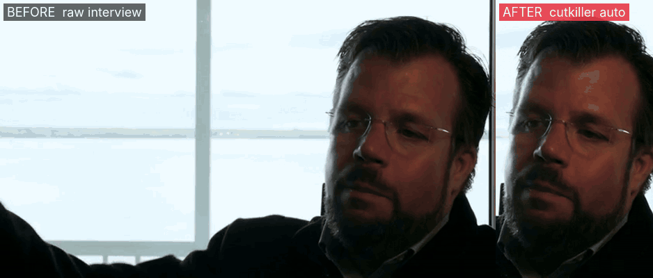

# CutKiller

**The open-source video editor that grades its own work.**

Raw footage in → a publish-ready YouTube video, Short, TikTok or Reel out — edited locally, for free, delivered with a **quality report scored on 26 measurable rules**.



<small>Real run on a 60 s CC BY interview (Global Lives Project): `cutkiller auto interview.mp4 music.mp3 -p short`, no manual step. Score 97.8/100.</small>

```sh
docker run --rm -v "$PWD:/work" -v cutkiller-models:/models \
  ghcr.io/baldw1n69/cutkiller auto interview.mp4 music.mp3 -p short -o out
```

## What it does

- **Cuts like an editor**: silences, hesitations (« um », « euh », « äh »…), false starts, at word accuracy, in 16 languages detected automatically.
- **Finishes for the platform**: 9:16 face tracking, karaoke captions in the safe zones, -14 LUFS voice with ducked music, beat-synced cuts and punch-ins, looks.
- **Proves it**: every render comes with `quality.md` — threshold, measurement and timecoded problems for each of the [26 rules](rules.md).
- **Works with your tools**: an editable JSON EDL, an [MCP server](agents.md) for Claude, Cursor or Codex, and [timelines](export.md) for Premiere Pro, DaVinci Resolve and Final Cut.

Next: [Getting started](getting-started.md).
